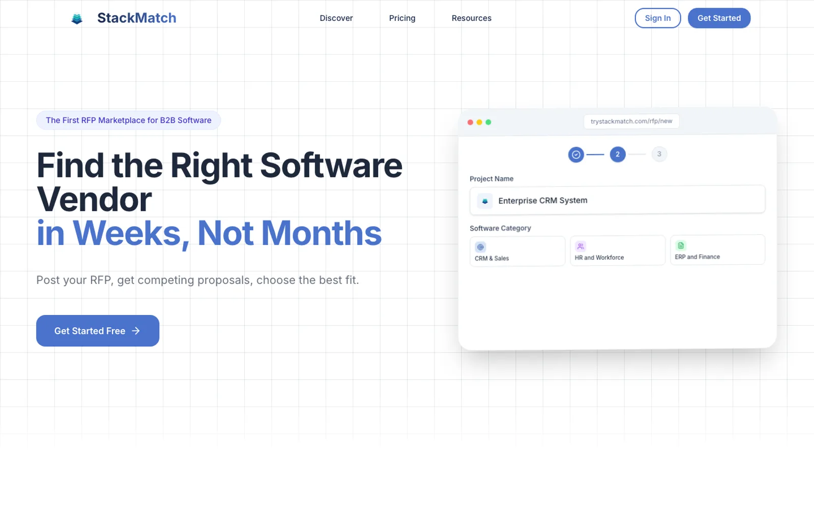

<div align="center">

# StackMatch

A three-sided marketplace for buying B2B software: buyers post what they need, vendors compete with proposals, and procurement consultants guide the deal.



<sub>The landing page from the later version of StackMatch.</sub>

</div>

---

## About this repo

This is the **first version** of StackMatch, built May to July 2025. It covers the core marketplace: listings, proposals, deal rooms, and dashboards for buyers and sellers. A later version added AI RFP writing, semantic vendor matching, and the landing page shown above.

## Features

- **Buyer and seller dashboards**: command centers with live listings, proposals, and activity
- **Guided listing wizard**: a step-by-step flow for writing an RFQ across 8 sections
- **Proposals**: vendors browse open listings and submit structured proposals, and buyers compare them
- **Deal rooms**: a shared workspace for each deal, with built-in e-signature
- **My Tech Stack**: track the software a company already owns, with licenses and renewals
- **Vendor directory, company profiles, and the StackTalk community forum**

## Stack

| Layer | Tech |
|---|---|
| Frontend | Next.js 15, React 18, TypeScript, Tailwind, shadcn/ui (Radix), Framer Motion |
| Data & auth | Supabase (Postgres, Auth, row-level security) |

## Running it

```bash
# .env.local needs NEXT_PUBLIC_SUPABASE_URL and NEXT_PUBLIC_SUPABASE_ANON_KEY
npm install
npm run dev
```

`CLAUDE.md` and the `CLAUDE-*.md` files are the working notes used while building it with Claude Code.

## Status

StackMatch is no longer live. The code is published here as a portfolio project. Read the case study at [diegofill.com/projects/stackmatch](https://diegofill.com/projects/stackmatch).

## License

MIT. See [LICENSE](LICENSE).

---

Built by [Diego Fill](https://diegofill.com).
